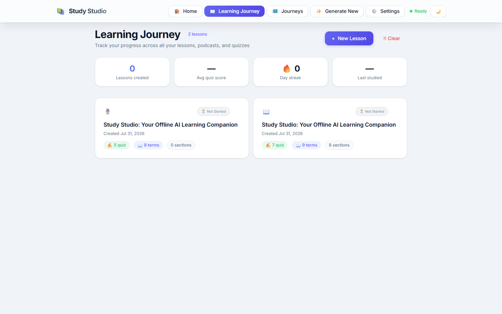
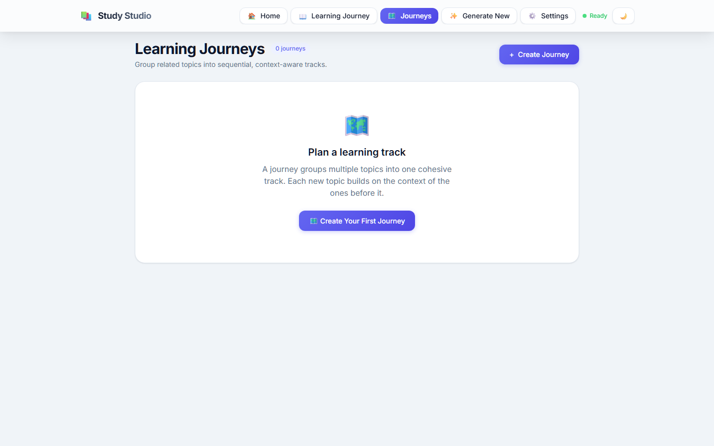
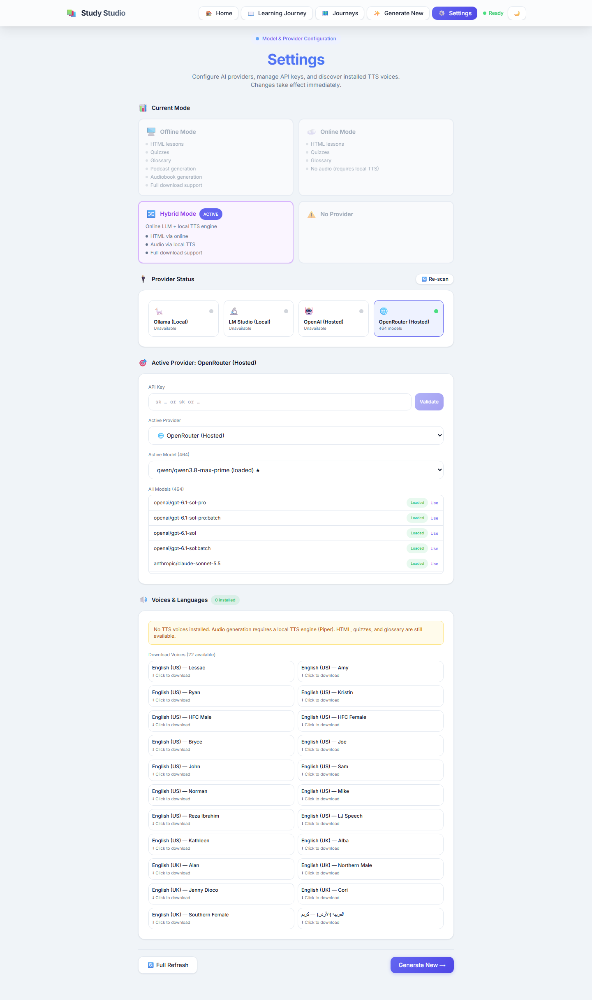
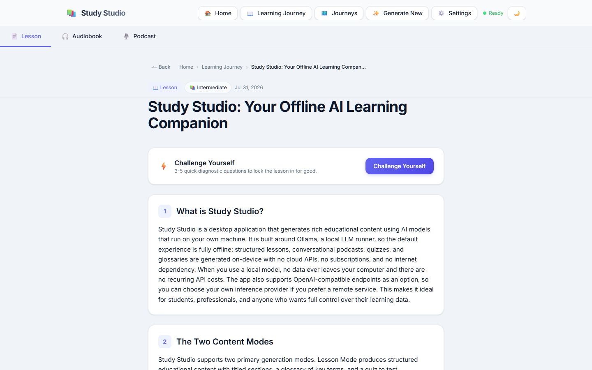
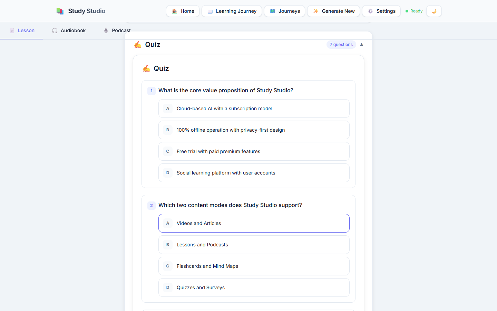

<div align="center">

# Study Studio


<!-- badges:start -->

[](https://github.com/Hatemshalaby15071979/Study-Studio/actions)

[](https://github.com/Hatemshalaby15071979/Study-Studio/commits/main)
)

*Measured 2026-10-06 — CI **success**; head `eb53cbd` (2026-10-05); TypeScript.*

<!-- No static test or coverage count is shown here: a frozen
     number decays silently. Run the suite for a current figure;
     the CI badge above is the live status. -->
<!-- badges:end -->

**A private, local-first AI tutor that runs on your machine.**

[](https://github.com/Hatemshalaby15071979/Study-Studio/actions/workflows/ci.yml)


</div>

## One-line identity

Study Studio is a private, local-first AI tutor that turns a topic into a lesson, a
dual-host podcast script, a glossary, and a quiz — without sending a word to the
cloud.

> [!NOTE]
> **Operating principle.** A local model is a tool the user owns, not a service that owns the user. Generation without an internet dependency is the default, not a privacy add-on: the app talks to a model runtime on the same machine, and with neither a model nor ffmpeg installed it simply tells you what is missing rather than reaching for a hosted API.

## Screenshots

Captured from the production static export (`apps/desktop/out`) served locally, in a fresh
browser profile: Library, Journeys and Settings on 2026-09-30, Lesson and Quiz on 2026-10-01.
No model runtime was running for any of them — the lesson and quiz are the app's own bundled
featured lesson, which the Library imports on first launch. No fixtures and no seeded data.

| Library | Journeys |
| --- | --- |
|  |  |

**Settings** — provider status, the active provider, and the voice catalogue:



**Lesson** — the bundled featured lesson, opened from the Library:



**Quiz** — the same lesson's quiz, expanded:



## What it does today

| Capability | Status |
| --- | --- |
| Structured lessons (sections, glossary, quiz) | Working |
| Dual-host podcast scripts (English / Arabic) | Working |
| Quiz scoring via Helix Core (sealed answer keys), optional AI evaluation | Working — requires `helix-core` |
| Piper TTS → MP3/WAV export | Working when voice models **and** ffmpeg are installed |
| Multi-provider runtime (LM Studio, Ollama, OpenAI-compatible, optional OpenAI / OpenRouter) | Working |
| On-demand model load from the app (no preloading in LM Studio) | Working |
| Learning Journey (progress, streaks, quiz scores) | Working |
| Library in IndexedDB with legacy localStorage migration | Working |
| Desktop installers (NSIS / MSI / portable) | Built for Windows x64 |
| Mobile client | **Removed** — the Expo scaffold was unreachable code |
| Hosted SaaS | **Not offered** and not planned as a requirement |

## How it fits Helix Codex

Study Studio is a **component** — the product layer that turns a local model into
study material. It is an **independent repository with no shared codebase** with Helix
Prime. No data pipeline is wired between it and the core today; it is portfolio-adjacent
and technically independent.

## Architecture

- `apps/desktop` — the whole application, and the only app package: a Next.js client
  (`src/app`, `src/components`, `src/hooks`, `src/lib`) inside a Tauri 2 shell
  (`src-tauri`, Rust). The Windows installer build target. There is no `apps/web` — the
  frontend is not a separate package.
- `apps/desktop/src/lib/ai-runtime/` — provider contract, capability detection, model
  selection (the runtime the coverage gate measures).
- `apps/desktop/src/lib/coreClient.ts` — the Helix Core client. Quiz scoring is owned
  by the core, not the client: the UI registers a quiz, receives public items with no
  answer key, and submits each answer for scoring.
- Library — IndexedDB with a localStorage migration path.

### Quiz scoring service

Quiz scoring is owned by the local Helix Core service (`helix-core`, in the
Helix-Education repository). There are two ways it reaches the app.

**Desktop app — automatic.** The Tauri shell spawns the core as a sidecar on
a free port, reads one line of stdout (`{"event":"ready","port":…,"token":…}`),
and proxies every call through the Rust command `core_fetch`. The port never
has to be known in advance and the bearer token never enters the webview.
Nothing needs to be started by hand.

The contract between the two repositories is pinned by a test:
`apps/desktop/src-tauri/tests/sidecar_contract.rs` launches the real sidecar
binary, parses its handshake with the production parser, and scores a real
quiz through the token the handshake carried. It also asserts that the
sidecar stops serving when its parent dies — a frozen sidecar is a
bootloader plus a worker, and the worker must not outlive the app.

The sidecar binary is built from the `helix-core` distribution and staged as
`src-tauri/binaries/helix-core-<target-triple>`:

```bash
npm run sidecar:build          # skips when the binary is current
npm run sidecar:build:force    # always rebuild
```

It needs `pyinstaller` on the Python you build with, and the core's source.
By default the script looks for `../Helix-Education/packages/helix-core`
next to this repository; override with `HELIX_CORE_SRC` and `PYTHON`:

```bash
HELIX_CORE_SRC=/path/to/Helix-Education/packages/helix-core \
PYTHON=/path/to/python node scripts/build-sidecar.mjs --force
```

`npm run tauri:dev` and `npm run tauri:build` run this automatically via the
Tauri `beforeDevCommand` / `beforeBuildCommand` hooks.

**Browser (`next dev` outside Tauri) — manual.** There is no sidecar to spawn,
so start the service yourself and point the app at it:

```bash
pip install helix-core          # or: pip install -e Helix-Education/packages/helix-core
helix-core --port 8765          # loopback only; add HELIX_CORE_TOKEN for auth
```

`NEXT_PUBLIC_HELIX_CORE_URL` (default `http://127.0.0.1:8765`) and, when
configured, `NEXT_PUBLIC_HELIX_CORE_TOKEN` apply to this path only.

In both cases, if the service is unavailable the quiz says so explicitly; it
does not fall back to client-side scoring. The answer key lives in the core's
`sealed_keys` table and is HMAC-verified before every score.

## Production status & test coverage

Snapshot 2026-11-10. The latest CI run on `main` is
[`42612798522`](https://github.com/Hatemshalaby15071979/Study-Studio/actions/runs/42612798522),
head `608fa1a25be4fdc0763380fca3780810250069cb` — all four jobs passed:
`typecheck, lint, versions`; `tests and coverage floors`;
`static export and design tokens`; and `mutation testing`.

The counts below are measured on that head, locally, with the same commands
CI runs. The run's own logs are the source for the job results; the log
download for it has expired, so the numbers are a local measurement against
the same commit rather than a copy out of the run.

| Check | Result | Source |
| --- | --- | --- |
| Test suites | 50 passed / 50 total | `npm run test:ci` at `608fa1a` |
| Tests | 1040 passed / 1040 total | `npm run test:ci` at `608fa1a` |
| Coverage (statements / branches) | 86.12% / 75.02% | `npm run test:ci` at `608fa1a` |
| Typecheck (`tsc --noEmit`) | Clean | CI run [`42612798522`](https://github.com/Hatemshalaby15071979/Study-Studio/actions/runs/42612798522), 2026-11-09 |
| Lint (`eslint src --max-warnings 0`) | Clean | CI run [`42612798522`](https://github.com/Hatemshalaby15071979/Study-Studio/actions/runs/42612798522), 2026-11-09 |
| Version manifests | Clean — 4 manifests agree | `npm run check:versions` at `608fa1a` |
| Release metadata | Clean — the version, the CHANGELOG and the tags agree | `npm run check:release` at `608fa1a` |
| Design-token guard | Clean — 20 token utilities, 1 stylesheet | CI run [`42612798522`](https://github.com/Hatemshalaby15071979/Study-Studio/actions/runs/42612798522), 2026-11-09 |
| Static export (`next build --webpack`) | Clean — 7 routes, all prerendered | CI run [`42612798522`](https://github.com/Hatemshalaby15071979/Study-Studio/actions/runs/42612798522), 2026-11-09 |
| Coverage floors (`check:coverage`) | Met — `src/lib/ai-runtime/runtime.ts` at 100% lines | CI run [`42612798522`](https://github.com/Hatemshalaby15071979/Study-Studio/actions/runs/42612798522), 2026-11-09 |
| Mutation testing (28 targeted mutations) | 28/28 caught | CI run [`42612798522`](https://github.com/Hatemshalaby15071979/Study-Studio/actions/runs/42612798522), 2026-11-09 |
| Cross-repo contract test | 3 passed / 3 total | `cargo test --test sidecar_contract` at `608fa1a` |
| Packaged build (NSIS + MSI) | Built on a Windows runner | [`.github/workflows/tauri-build.yml`](.github/workflows/tauri-build.yml) |
| Secret scan (tree + history) | No findings | `.github/workflows/secret-scan.yml` |

> [!IMPORTANT]
> **CI is green on `main`.** The latest run is
> [`42612798522`](https://github.com/Hatemshalaby15071979/Study-Studio/actions/runs/42612798522)
> (2026-11-09, head `608fa1a25be4fdc0763380fca3780810250069cb`, branch `main`, event `push`); all four jobs passed:
> `typecheck, lint, versions`; `tests and coverage floors`; `static export and design tokens`;
> and `mutation testing`.
>
> The two jobs that had been red were fixed rather than muted. `Coverage floors` failed on
> `runtime.ts` at 94.63% lines against a 95% floor, and is closed with five behavioural tests
> — the floor is unchanged and no `istanbul-ignore` was added. `mutation testing` failed
> because one mutation, `validation-chunk-minimum-lines-removed`, drove its target suite into
> an await-only microtask loop that Jest's timer-based `testTimeout` cannot interrupt: the
> worker exhausted the V8 heap and died by SIGKILL, which the harness reported as a timeout.
> It was retargeted at the schema's own suite (`validation.test.ts`), where it fails fast and
> deterministically. No floor was lowered and no mutation was deleted.

> [!WARNING]
> Live opt-in suites exist for LM Studio and Ollama (`LMSTUDIO_LIVE=1`, `OLLAMA_LIVE=1`); without those env vars CI stays hermetic. Generation needs a local model runtime. Audio export needs Piper voice files plus ffmpeg. On a clean machine with neither, the app will not produce lessons or audio. The mobile client was removed, and a hosted SaaS is not offered. No external audit, no certified data isolation, no signed security review, no revenue.

## Run it

Verified on a clean clone on 2026-09-30: `git clone` → `npm install` → `npm run dev`
serves the app on http://localhost:3000.

### Browser (fastest)

```bash
cd apps/desktop
npm install
npm run dev
```

Open http://localhost:3000. The app sets `trailingSlash: true`, so routes resolve with a
trailing slash — `/generate/`, `/library/`, `/settings/`; the unslashed form returns a
redirect.

> [!NOTE]
> **Bundler policy: `dev` is Turbopack, `build` is webpack.** `dev` and `dev:host` pass no
> flag; `build` and `build:prod` pass `--webpack`, and that flag is not redundant —
> Turbopack's static export emits no `out/_next/static/css/`, so the design-token guard fails
> with *"no compiled stylesheet found"* (measured both ways). The Turbopack conflict that
> once forced `--webpack` everywhere was a version mismatch, not a Next limitation:
> `@next/bundle-analyzer` was pinned `^14.2.35` against Next `^16.3.6`, and 14.x injects a
> `webpack` config unconditionally, which Turbopack refuses. The analyzer is now on 16.x and
> `next dev` runs clean.

In a browser, calls to local runtimes go direct over HTTP, so those servers must allow
CORS. The desktop shell routes through Rust and does not have that constraint.

### Desktop (requires the Rust toolchain)

```bash
cd apps/desktop
npm install
npm run tauri:dev      # development
npm run tauri:build    # packaged app
```

`npm run tauri:dev` starts the dev server through `scripts/dev-warm.mjs`, which shells out
to `npm run dev` — so it inherits the Turbopack policy above.

`npm run tauri:build` runs `sidecar:build` and `build:prod` first, then packages the
app. **The sidecar must be built for the platform you are packaging for.** PyInstaller
compiles for the machine it runs on, so a Windows installer has to be built on Windows —
the script refuses to cross-compile rather than writing a binary with the wrong
architecture under the right name.

What each platform produces:

| Platform | Bundle | Produced by |
| --- | --- | --- |
| Windows | NSIS installer (`.exe`) and MSI (`.msi`) | `npm run tauri:build` on Windows |
| Linux | `.deb` | `npm run tauri:build` on Linux |
| macOS | `.dmg` / `.app` | `npm run tauri:build` on macOS |

The installers land in `apps/desktop/src-tauri/target/release/bundle/`.

To package against a different version of the core, point the sidecar build at that
source:

```bash
HELIX_CORE_SRC=/path/to/Helix-Education/packages/helix-core \
  npm run sidecar:build:force --prefix apps/desktop
```

For local models, LM Studio (port `1234`) or Ollama (port `11434`). For audio, install
Piper voice models **and** ffmpeg.

### Rolling back

See [docs/ROLLBACK.md](docs/ROLLBACK.md). In short: a rollback is a reinstall of the
previous version, and the lesson library survives it.

## Related work

See the [profile README](https://github.com/Hatemshalaby15071979) for how this project
fits the wider work.

## Author

Built by Hatem Shalaby, Contact Centre Operations & AI Implementation Lead | WFM & CX Transformation. Background: https://github.com/Hatemshalaby15071979

## Licence

MIT
